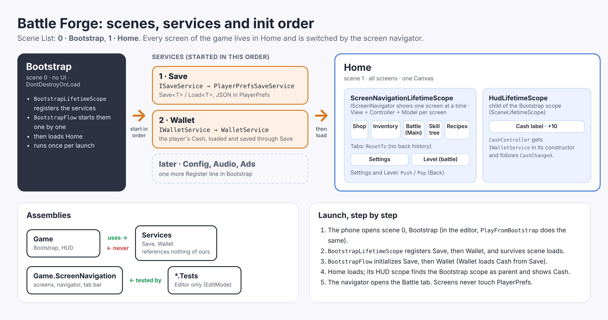

# Battle Forge

**Team:** Eden Lagziel · Alan Zirkiev
**Course:** Mobile Game Development, Shenkar

## The game in one sentence
Take 4 cards into a real-time lane battle, craft more on a 3×3 table (a rare Soul makes them stronger) and destroy the enemy base; come back tomorrow for daily rewards, quests and new cards to unlock.

## How to open and build
1. Open the project in Unity 6000.6.7f1 (the version approved by the course).
2. File → Build Profiles → Android → Switch Platform.
3. Build and run on an Android phone. In the editor, Play always starts from the Bootstrap scene.

## Architecture

- **Bootstrap** (scene 0, no UI) starts the services in order, keeps them alive with DontDestroyOnLoad, then opens **Home** (scene 1).
- **Services** sit behind interfaces in their own assembly: 1 · `ISaveService` (PlayerPrefs, JSON), 2 · `IWalletService` (the player's Cash, saved through Save). Screens get them by constructor injection (VContainer) and never touch PlayerPrefs.
- **Home** holds every screen, including the battle: tabs switch with the screen navigator, Settings and Level open on top and close with Back.
- **Assemblies**: `Game` → `Services`; `Services` references nothing of ours. Details in `AGENTS.md`.

## Repo map
| File | What it is |
| --- | --- |
| `pitch.md` | One-page pitch of the game |
| `DECISIONS.md` | Every real decision the team made, and why |
| `AGENTS.md` | Context for AI coding tools: architecture, rules, conventions |
| `CLAUDE.md` | Points Claude Code to `AGENTS.md` |
| `docs/architecture.webp` | The architecture diagram above |
